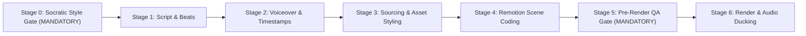

# Vox & Tactile Motion Graphics Production Orchestrator

This skill directs the complete lifecycle of a motion graphics video—from interactive Socratic style alignment and audio-first beat-sheet calculation to 2.5D/3D Remotion animation, visual QA verification, and final production assembly.

All rules defined in [`rules/AGENTS.md`](../../rules/AGENTS.md) are strictly binding across all stages.

---

## 7-Stage Production Pipeline



---

### Stage 0: Socratic Style Gate (MANDATORY Before Any Video Creation)

> 🔴 **CRITICAL PROTOCOL:** Never assume a single style or begin scripting/animating blindly when asked to create a video on any topic. You MUST first initiate the **Socratic Style Gate** to finalize:

#### Gate 1: Visual Style & Aesthetic Archetype
- **Option A — Vox v3.0 Halftone & Cutout Collage (`vox-halftone-cutout`)**:
  - *Best for*: Investigative journalism, geopolitics, economic exposes, systemic breakdowns.
  - *Canvas*: Dark teal cutting mat (`#123544`) with technical grid/protractor arcs and overhead physical desk tools (tailor shears, marker pen, wire clips).
  - *Subjects*: 100% monochrome B&W newspaper halftone print (`Ben-Day` dots) with thick solid white angular scissor border (`8px–14px`) and constructivist horizontal slicing backed by Cadmium Yellow (`#F2B705`) or Vox Stamp Red (`#D62828`).
- **Option B — Tactile Retro-Digital Ephemera (`retro-digital-ephemera`)**:
  - *Best for*: Cultural history, computing evolution, human interest, nostalgia essays, design history.
  - *Canvas*: Warm cream deckle cardstock (`#F4EFE6`) with pulp fibers, alternating with deep matte void (`#0C0C0C`).
  - *Subjects*: Authentic mechanical hardware cutouts (typewriters, CRT monitors, Nokia 3310, Japanese Garakei flip phones, vintage iPhones) with subtle contact drop shadows.
  - *Typography*: 1-bit coarse dithered serif with blinking typewriter cursor (`_`), dual-ribbon red accents (`#DE3831`).
- **Option C — Swiss Technical / Modern Vector (`swiss-technical`)**:
  - *Best for*: SaaS product teardowns, fintech data explainers, futuristic tech architecture.
  - *Canvas*: High-contrast vector grid (`#0F1115` or `#F8F9FA`), Neue Haas Grotesk/Inter bold typography.
  - *Accents*: International Orange (`#FF4400`) or Electric Blue (`#0055FF`), precision coordinate rulers, fluid easing (30/60fps).
- **Option D — Custom / Reference-Driven**:
  - *Best for*: Replicating a specific brand, Pinterest pin, or YouTube reference video via `sm learn <name> <ref>`.
- **Option E — Cinematic Science & Hyper-Realistic 3D (`cinematic-science-3d`)**:
  - *Best for*: Extreme physics "What If" scenarios (relativistic collisions, cosmic events, planetary catastrophes, atomic reactions).
  - *Benchmark Reference*: *"What If an Egg Hit New York at Light Speed?"* (`youtube.com/shorts/l5c5tMpeh7M`), *Whatfinity*, Randall Munroe's *xkcd* relativistic simulations.
  - *Canvas & Scale*: Real-world recognizable macro anchors (egg in hand, needle on fabric, human eye), photorealistic physical locations (Manhattan skyscrapers, geological crust), and Hollywood-grade volumetric blast VFX (expanding incandescent fireballs, supersonic shockwave dust rings, glass shattering).
  - *Engine Stack*: Headless Blender (`blender-production`) or Cinematic AI Video (`ai-video-pipeline`) for 3D/VFX render passes + Remotion as Master Compositor (kinetic typography, microsecond audio synchronization, real-time Special Relativity HUD telemetry). Zero toy WebGL geometric primitives.

#### Gate 2: Hardware Storytelling Portals
- *Decision*: Will this narrative use dedicated physical device frames as storytelling portals (e.g., CRT scanlines for the 80s, Nokia monochrome LCD for 2000s, Garakei for Y2K Japan, vintage Mac for 90s, Oscilloscope/Strip-Chart for physics telemetry), or remain strictly tabletop collage?

#### Gate 3: Motion Cadence & Physics
- *Decision*: Stepped tactile stop-motion (10–15fps updates on 2s/3s via `Math.floor(frame / 2) * 2` with snappy mechanical springs) or fluid modern keyframe animation (30/60fps)?

#### Gate 4: Aspect Ratio & Target Platform
- *Decision*: 9:16 Vertical Short/Reel (30–60s fast-paced hook) vs. 16:9 Long-Form Documentary (2–5 min)?

---

### Stage 1: Script & Beat Architecture (Audio-First)

1. **The 15-Second Inversion Hook (MANDATORY)**:
   - The opening MUST NOT open with chronological textbook history (e.g., *"In May of 1964, on a quiet hill..."*).
   - The first 5 to 15 seconds must state a jarring paradox: `[Familiar Modern Norm / Accepted Reality]` -> **AUDIO DROP** -> `[Shocking Opposing Origin / Uncomfortable Mechanism]`.
2. **Narrative Synchronization & Anti-Spoiler Invariant**:
   - Visual elements representing mystery culprits, twists, or punchlines MUST NOT appear in earlier beats before the voiceover introduces them (see [`rules/AGENTS.md §7`](../../rules/AGENTS.md)).
3. **Dynamic 5-Layout Matrix Rotation**:
   - Each beat in `beat-sheet.json` MUST explicitly declare its `layoutType`:
     `kinetic_type_slam` | `macro_document` | `suspect_grid` | `hardware_portal` | `split_memo`
   - Rotate layouts actively; no single layout may persist for more than 2 consecutive beats.
4. **Format Pacing & Word Count Guidelines**:
   - Narrative speaking rate: **140–160 WPM** (~2.5 words per second).
   - **9:16 Vertical Short (30–60s)**: 5–8 beats total (~75–150 words).
   - **16:9 Long-Form Explainer (2–5 min)**: 15–25 beats total (~300–750 words).
   - Pacing target: 8–12 seconds per beat (20–30 words per beat). Avoid beats exceeding 15 seconds.
5. Validate format against [beat-sheet-schema.json](./references/beat-sheet-schema.json).

---

### Stage 2: Voiceover Synthesis & Exact Frame Alignment

> ⚠️ **Audio drives timing:** Never start Remotion visual animation before confirming exact duration in frames.

Run the voiceover generator using expressive female delivery (`en-US-AvaNeural` primary with +6% speed rate):

```bash
python .agents/plugins/vox-motion-studio/skills/vox-motion-graphics/scripts/tts_engine.py \
  --text "In 1964, two scientists accidentally heard the birth of our universe. But for an entire year... they were convinced it was just warm pigeon droppings." \
  --out "public/audio/beat_01.mp3" \
  --voice "en-US-AvaNeural"
```

Calculate frame duration at 30fps:
$$\text{durationInFrames} = \lceil \text{duration\_seconds} \times 30 \rceil$$

---

### Stage 3: Asset Styling, Provenance & Sourcing Pipeline

#### Archival Asset Sourcing & Verification Protocol (Institutional-First)
1. **Institutional Repository Priority**: For any named researcher, scientist, or historic actor, query their home institution's official digital archives first:
   - `site:<university.edu> "<Researcher Name>" (portrait OR photo OR faculty OR memorial)`
   - `site:<institution-domain> "<Researcher Name>" (archives OR "special collections")`
   - Examples: Princeton Physics (`phy.princeton.edu`), Bell Labs, MIT, NASA, Caltech, or National Academy of Sciences Biographical Memoirs.
2. **Visual Content Verification**: Always inspect downloaded assets to confirm an actual facial likeness. Never accept title pages, journal headers, or book covers as portraits.
3. **Asset Variety Ceiling**: Strict ceiling of **max 2 appearances** per individual asset across an entire video project to prevent viewer fatigue.
4. **Niche Scarcity Fallback**: When <5 authentic photographs exist for an obscure topic, do NOT pad with generic stock photos. Instead, use:
   - High-resolution forensic macro crops/details of the hero photo (max 2 details).
   - Period documents, blueprints, patents, newspaper scans, or maps.
   - Procedural Manim telemetry, waveforms, or system plots.
   - Bold constructivist kinetic typography slams.
5. **Multi-Person Crowded Beat Priority**: When multiple researchers are named in a single beat, use a group archival photograph or display the primary lead as hero cutout with secondary collaborator as an offset companion card (max 2 portraits per frame).
6. **Provenance & Rights Logging**: Record source URL, archival repository, and copyright/public domain status in `01_research/sources.json`.
7. **Asset Storage Discipline (Zero C-Drive Bloat)**:
   - Store all project assets in `projects/<Video_Title>_<YYYY-MM-DD>/04_images/`.
   - Never leave temporary image downloads on the `C:` drive.

#### Cinematic 3D & Physical Realism Engine Protocol (Anti-Primitive Invariant)
When Archetype E (`cinematic-science-3d`) or any topic involving violent physical destruction, macro real-world objects, or cinematic scale is selected, the pipeline MUST enforce the Tripartite Production Gate:
1. **Zero Toy Geometric Primitives**: Never attempt to simulate real-world macro subjects (everyday objects, food, tools, biological bodies, buildings, cities) or violent physical phenomena (explosions, blast shockwaves, crater excavations, atmospheric ionization) using raw, untextured Three.js geometric primitives (`CylinderGeometry`, `SphereGeometry`, displaced flat planes, or basic wireframe rings). Primitive shapes produce sterile, unconvincing CAD diagrams that destroy audience engagement.
2. **Tripartite Production Gate**:
   - **Path A — Headless Blender Pipeline (`blender-production`)**: Automated Python scripting (`blender -b -P script.py`) leveraging Eevee Next / Cycles, Mantaflow volumetric smoke/fire, rigid-body fracture, PolyHaven PBR materials, and realistic camera optics (focal length, depth-of-field, motion blur).
   - **Path B — Cinematic AI Video Generation (`ai-video-pipeline`)**: Photorealistic 3–6 second generative video clips for hyper-realistic macro shots, city-scale destruction, and atmospheric re-entry, stitched and color-graded cleanly.
   - **Path C — Production-Grade glTF/PBR Assets**: High-poly textured models with HDR environment maps and realistic PBR materials if rendered within `@remotion/three`.
3. **Remotion as the Master Compositor**: Remotion's primary role is orchestration, neural audio synchronization, kinetic editorial typography, camera tracking, and scientific HUD telemetry overlays—NOT raw real-time fluid simulation or volumetric ray-tracing.

#### AI Video Sub-Pipeline (Credit-Conscious Generation & Local Upscaling)
1. **Model**: Omni 1.2 Flash (`omni-flash`) via `google-flow-mcp`.
2. **Parameters**: Minimal duration sub-15s (4s, 6s, or 8s), 360p base generation (6 credits vs 18 credits for 720p).
3. **Local Upscaling to 1080p**: Immediately upscale locally via FFmpeg with Lanczos filtering:
   ```powershell
   ffmpeg -i "05_output/flow_clip_360p.mp4" -vf "scale=1920:1080:flags=lanczos" -c:v libx264 -crf 18 -preset slow -c:a copy "05_output/flow_clip_1080p.mp4"
   ```

---

### Stage 4: Remotion Scene Coding & Assembly Patterns

#### Architecture: Data-Driven Templates
Video compositions should use a data-driven scene manifest (`src/data/<project>_scenes.json`) rendered through archetype templates (`src/templates/<ArchetypeTemplate>.tsx`).

#### Production Layout & Assembly Invariants

1. **Stateful Alternating Spatial Choreography (Anti-PowerPoint Flow)**:
   Never allow consecutive split scenes to share the same media/text alignment. Non-split beats (kinetic slams, full-bleed portals) do NOT reset or toggle the alternation flow:
   ```tsx
   // Explicit curated set or stateful helper ensuring split layouts alternate
   const MEDIA_RIGHT_BEATS = new Set([3, 8, 11, 13, 14, 17, 20, 22]);
   const isMediaLeft = !MEDIA_RIGHT_BEATS.has(scene.id);

   <div style={{ display: "flex", flexDirection: isMediaLeft ? "row" : "row-reverse", gap: 52 }}>
     <div style={{ flex: "1 1 54%" }}>{/* Media Cutout / Evidence */}</div>
     <div style={{ flex: "1 1 46%" }}>{/* Narration Receipt / Text */}</div>
   </div>
   ```

2. **Subject-Conforming Paper Cutouts (Zero Generic Box Letterboxing)**:
   Cutouts must hug the subject silhouette or exact image aspect ratio (`width: fit-content`). Never place photos in oversized rectangular boxes with empty white flanks:
   ```tsx
   <div style={{ display: "inline-block", width: "fit-content", position: "relative" }}>
     <HalftoneCutout src={scene.image} height={430} sliceBand={false} />
   </div>
   ```

3. **Authenticity-First (No Gimmick 3D/SVG Overlays)**:
   - Real archival media takes center stage with generous negative space.
   - Never superimpose synthetic 3D or fake SVG meters over or next to real photos.
   - Reserve 3D/procedural meshes strictly for unphotographable physics or standalone interactive device portals.

4. **Speech-Synchronized Staggered Entry & Tactile Micro-Motion**:
   - Desk card settles at frame 0.
   - Hero document enters at spoken noun frame (`stiffness: 180, damping: 12`).
   - Fasteners (Scotch tape, paperclips) snap at +6 to +10 frames (`stiffness: 220, damping: 14`).
   - Historical labels and stamps punch down at +12 to +16 frames (`stiffness: 220, damping: 14`).
   - Subtle mathematical breathing maintains tactile desktop realism:
     ```tsx
     const floatY = Math.sin((frame + seed) * 0.08) * 4;
     const floatRot = Math.cos((frame + seed) * 0.05) * 0.8;
     ```

5. **Unmistakable Animated Paper-Cut Speech Bubbles**:
   When a character or historic figure has spoken dialogue or a prominent quote, trigger an authentic SVG speech balloon (`PaperSpeechBubble.tsx`):
   ```tsx
   <PaperSpeechBubble
     text="“Boys, we have been scooped.”"
     speaker="Robert Dicke · Princeton"
     startFrame={170}
     pointerDirection="bottom-left"
     x={60}
     y={-120}
     width={380}
     fontSize={24}
   />
   ```
   - Must use organic balloon geometry (smooth SVG arc or `borderRadius >= 18px`), dark stroke (`3.5px solid #141414`), bright white fill, and an integrated pointer tail aimed squarely at the speaker's mouth.
   - Strictly contain quotation text—never colored metadata banners that confuse it with a filing index card.

6. **Stepped Stop-Motion Cadence (When Active)**:
   When Gate 3 selects stepped tactile stop-motion, quantize time within the 30fps canvas:
   ```tsx
   const steppedFrame = Math.floor(frame / 2) * 2; // 15fps stepped motion updates
   ```

7. **Procedural `<canvas>` Drawing Kits (`@animate` Hybrid Bridge)**:
   For tactile boiling ink (`crosshatch`), multi-ink Risograph overprints (`riso`), 30° axonometric architecture (`isometric`), or sketchbook annotations (`sketchbook`), mount [`ProceduralCanvas.tsx`](../../../../src/ProceduralCanvas.tsx) directly inside Remotion scenes or export alpha-transparent VP9 `.webm` overlays via `.\an.ps1 render <slug> --transparent --webm`:
   ```tsx
   <ProceduralCanvas kit="riso" id={scene.id} bpm={120} transparent={true} />
   ```

---

### Stage 5: Pre-Render QA Gate (MANDATORY Before Full Render)

> 🔴 **CRITICAL PROTOCOL:** Never launch a full production render without first rendering and inspecting still frames at key narrative beats.

1. **Render Key QA Stills & Contact-Sheet Storyboard**:
   ```bash
   npx remotion still <CompositionID> "projects/<Title>_<Date>/05_output/qa_beat<N>_f<Frame>.png" --frame=<Frame>
   # Or generate a full-timeline Contact-Sheet Storyboard & Style Comparison via @animate:
   .\an.ps1 storyboard <slug>
   .\an.ps1 compare <ref.png> <candidate.png>
   ```
2. **8-Point Visual QA Checklist**:
   - [ ] **Contrast**: Narration typography and headlines are instantly legible against background surfaces.
   - [ ] **Non-Occlusion**: 100% of hero photographic subjects, faces, and technical blueprints are unobstructed.
   - [ ] **Forensic Relevance**: Zero blind callout circles over portraits or faces; circles target verified evidence only.
   - [ ] **Snug Framing**: Zero empty white letterboxing flanks; cutout borders hug image silhouettes.
   - [ ] **Alternating Flow**: Consecutive split scenes alternate spatial direction (Left-Media vs Right-Media).
   - [ ] **Speech Balloon**: Quotes appear in distinct comic/editorial balloons with tails aimed at speaker mouths.
   - [ ] **Archival Likeness**: Every portrait depicts the verified historical figure (no manuscript/paper scans).
   - [ ] **3D Realism & Benchmark Fidelity**: Zero toy geometric primitives representing real-world macro subjects or violent destruction. All 3D passes match the photorealistic benchmark fidelity (Blender Cycles/Eevee render passes, cinematic AI video clips, or production glTF assets).

---

### Stage 6: Final Production MP4 Render & Audio Ducking

1. **Production MP4 Render**:
   ```powershell
   powershell -ExecutionPolicy Bypass -File .agents/plugins/vox-motion-studio/skills/vox-motion-graphics/scripts/render_remotion.ps1 -Action render -Composition "<CompositionID>" -OutFile "projects/<Video_Title>_<YYYY-MM-DD>/05_output/<title>.mp4"
   ```
2. **Audio Bed & Ducking**: Background music bed (or procedural BPM score synthesized via `.\an.ps1 beats <slug>`) ducks by `-14dB` during active voiceover segments.
3. **Verify Render Output**: Confirm exit code 0, check file size (>50MB for multi-minute 1080p), and verify audio-visual synchronization.

---

## Quick Reference Links
- 🎨 [Vox Style & Design Tokens](./references/vox-style-guide.md)
- 🌐 [Three.js & Remotion Patterns](./references/threejs-remotion-patterns.md)
- 📋 [Beat Sheet JSON Schema](./references/beat-sheet-schema.json)
- 🖌️ [Universal Procedural `<canvas>` Skill (`@animate`)](../../../skills/animate/SKILL.md)
