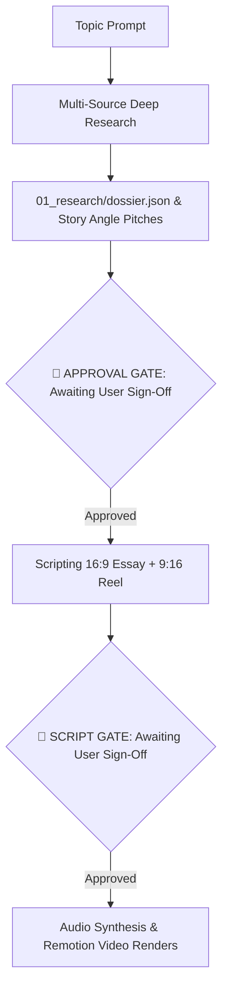

# Vox Investigator: Full-Stack Autonomous Documentary Workflow

## Core Directives

### 1. Research Protocol (All Sources + Google Search)
- Conduct multi-query search passes using `search_web`, Wikipedia, government reports, corporate filings, and academic databases.
- Require at least 2 primary source URLs per factual claim.
- Compile findings into `01_research/dossier.json`.

---

### 2. Dual-Format Output Architecture

| Format | Aspect Ratio | Duration | Target Beats | Narrative Strategy |
|---|---|---|---|---|
| **Long-Form Essay** | **16:9** (1920×1080) | 2–5 minutes | 8–12 beats | Deep investigative dive, historical context, step-by-step mechanism, complication, systemic takeaway. |
| **Shorts / Reels** | **9:16** (1080×1920) | 30–60 seconds | 3–4 beats | **Aggressive 3-second hook**, high visual velocity, single core paradox, punchy punchline. |

#### 2.1 Universal Explainer Video Grammar & Invariants
1. **The 15-Second Inversion Hook**: Open with cognitive dissonance: `[Modern Norm / Accepted Reality]` -> `[Shocking Opposing Origin / Uncomfortable Mechanism]`.
2. **Macro-to-Micro 8-Second Pulse**: Alternate between high-level overview (system map, distribution) and micro proof (tangible memo, isolated cutout, highlighted quote) every 6–10 seconds.
3. **Forensic Data Climax**: Charts and graphs must be scripted as the decisive evidence resolving the central question, not passive educational breaks.
4. **10-Frame Felt Highlighter Sweep**: Animate semi-transparent felt marker strokes across the exact 2–3 operative words being spoken.
5. **Continuous Z-Axis Drift**: Zero motionless frames; apply continuous scale push (`1.0 -> 1.05`) across all scenes.

---

### 3. Mandatory Human-in-the-Loop Approval Gate

> ⚠️ **STRICT ENFORCEMENT:** Never synthesize voiceover audio or execute video rendering before the user explicitly approves:
> 1. The Research Dossier & selected story angle.
> 2. The narration scripts for both formats.
